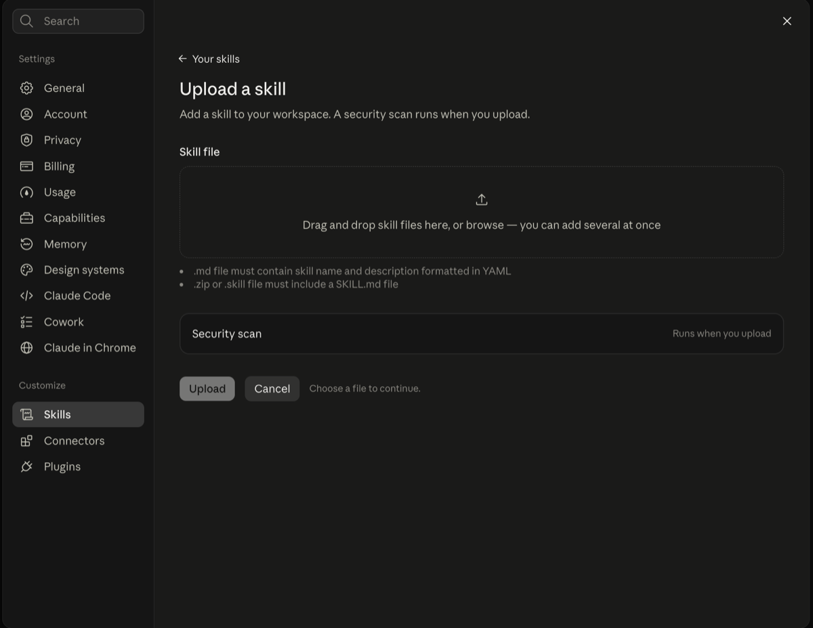
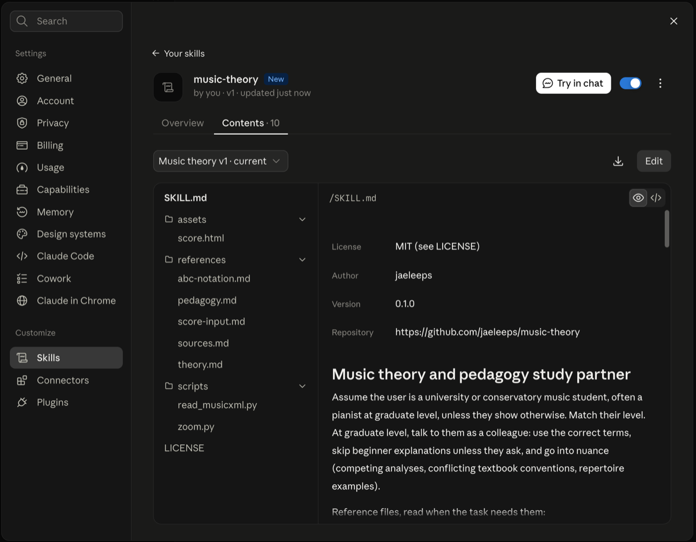

# Using music-theory in claude.ai

This guide is for using the skill on the Claude website ([claude.ai](https://claude.ai)) or in the Claude desktop and mobile apps. You don't need to install anything on your computer.

## 1. Turn on code execution (one time)

Skills only work when Claude can run code.

- **Free, Pro, or Max plan**: open [Settings → Capabilities](https://claude.ai/settings/capabilities) and turn on **Code execution and file creation**.
- **Team or Enterprise plan**: an admin has to turn on **Cloud code execution and file creation** and **Skills** in [Organization settings → Plugins & skills](https://claude.ai/admin-settings/skills) (the **Policy** tab).

## 2. Download the skill

Download **`music-theory.zip`** from the [latest release](https://github.com/jaeleeps/music-theory/releases/latest). Don't unzip it.

<details>
<summary>No release yet, or want the newest unreleased version? Build the zip yourself.</summary>

Download the repository (**Code → Download ZIP** on GitHub) and unzip it. Then make a zip of the folder `skills/music-theory`. The zip must contain the folder `music-theory/` with `SKILL.md` inside it, and the folder name must stay `music-theory`. From a terminal:

```bash
cd skills && zip -r ../music-theory.zip music-theory
```
</details>

## 3. Upload it

1. Open [Customize → Skills](https://claude.ai/customize/skills).
2. Click **+**, then **+ Create skill**, then **Upload a skill**.
3. Drop `music-theory.zip` onto the box (or click to browse), then click **Upload**. claude.ai runs a security scan on the file.

   

4. The skill opens on its own page. Make sure the switch at the top right is on. The **Contents** tab lists the skill's files, and **Try in chat** starts a chat with it.

   

## 4. Use it

Start a new chat and ask normally. Claude loads the skill on its own when the question is about music theory, analysis, or piano pedagogy. Some things to try:

- *"Show me a German augmented sixth resolving to V in C minor."*
- *"Quiz me on seventh-chord inversions, one question at a time."*
- *"Check my part-writing."* Attach a photo of your chorale, or type the notes (e.g. "S: E5 D5 C5, A: G4 G4 E4 …").
- *"Compare the reading approaches of Piano Adventures and The Music Tree."*
- *"Analyze bars 1–8 of this."* Attach a MusicXML file, an `.mtext` file, a PDF, or a phone photo of the page (see section 5).

**What you'll see**
- Musical examples open in a panel next to the chat (an *artifact*), drawn on real staves.
- Press **▶ Play** to hear an example. (The sound is a simple built-in synthesizer, not a real piano.)
- A **red box** under a staff means the notation has an error. Tell Claude, and it will fix it.
- Under each staff, the notes are also written out in text, so you can check them or ask about a specific one.

**Tips**
- Tell Claude which textbook your course uses (e.g. Aldwell & Schachter, Kostka & Payne, Laitz). Labeling conventions differ between textbooks, and Claude will follow yours.
- For ear training, ask Claude to hide the answer. It will draw the example without labels, and you press Play.

## 5. Send a score

Attach the file to your message and say which bars you want to work on. Claude reads only those bars, so there are fewer chances for mistakes.

| What you send | How Claude reads it | How accurate |
|---|---|---|
| **MusicXML** (`.musicxml`, `.xml`, `.mxl`) | Reads every note from the file with a script. | Exact. The best choice for long or graded work. |
| **`.mtext`** (plain-text score) | Reads the text directly. | Exact. If the file came from a scan, check the bars that matter. If claude.ai won't attach the file, paste its text into the message instead. |
| **PDF or screenshot** | Cuts the page into enlarged crops and reads them by eye. | Very good on clean engraving (96–100% of notes in testing). |
| **Phone photo** | Straightens the page, evens out shadows if needed, then reads enlarged crops. | Very good on a clear photo (96–100% of notes with the current version in testing), but always check it. |

**Getting MusicXML.** Any notation program can export it: in MuseScore, Finale, Sibelius, or Dorico, use **File → Export → MusicXML**. Many scores on IMSLP and MuseScore.com have a MusicXML version you can download.

**Taking a good photo**
- Get the whole page, or the system you want, inside the frame. Claude finds the page's four corners, so a slight slant or some table showing is fine.
- Lay the page flat. A curled page bends the staff lines.
- Use even light. Avoid your own shadow across the music and glare on glossy paper.
- For dense piano music or small print, take a close photo of one system (one line of music) at a time. If the staff lines are too small, Claude will say so and ask for a closer photo, because enlarging can't recover detail the photo doesn't have.

**What happens next**
1. Claude names the clefs, key, and meter it sees, and asks which bars matter if you didn't say.
2. It transcribes those bars, marks any note it isn't sure of with `?`, and writes `??` for a note it can't read. It never guesses a note from what the harmony "should" be.
3. It draws its transcription on a staff, with the notes also written out in text, and lists the uncertain notes.
4. **You compare it with your score bar by bar** and correct anything wrong. Claude analyzes only after you confirm.

Notes marked uncertain are wrong much more often than the rest, so check those first. The [score-reading test](score-reading-test.md) has the details.

**Asking for `.mtext`.** Claude can also write a passage as `.mtext`, for example to paste into a notation app that reads the format: *"Write this chorale as .mtext."*

## Updating to a new version

Open [Customize → Skills](https://claude.ai/customize/skills), turn **music-theory** off, click **…** → **Delete**, and then upload the new zip as in step 3.

## If something doesn't work

| Problem | Fix |
|---|---|
| The upload is rejected | Check that the zip contains a `music-theory/` folder with `SKILL.md` in it, not the files on their own or a folder with a different name. |
| Claude doesn't seem to use the skill | Check that the skill's switch is on and code execution is enabled (step 1). Or ask directly: *"Use the music-theory skill to …"*. |
| The staff panel shows the ABC text instead of notes | The notation library couldn't load. Reload the page. If it keeps happening, ask Claude for the ABC text and paste it into any ABC viewer. |
| No sound | Click **▶ Play** again (browsers only allow sound after you click), and check that your device isn't muted. |
| Claude says the photo's staff lines are too small, or can't find them | Take a closer photo of one system at a time, flat and in even light. Or send a MusicXML file instead. |
| The transcription of a photo has wrong notes | Correct them in the chat ("bar 3, beat 2 in the left hand is E♭, not F"), and Claude updates the staff before analyzing. |

Help Center reference: [Using Skills in Claude](https://support.claude.com/en/articles/12512180-using-skills-in-claude).
